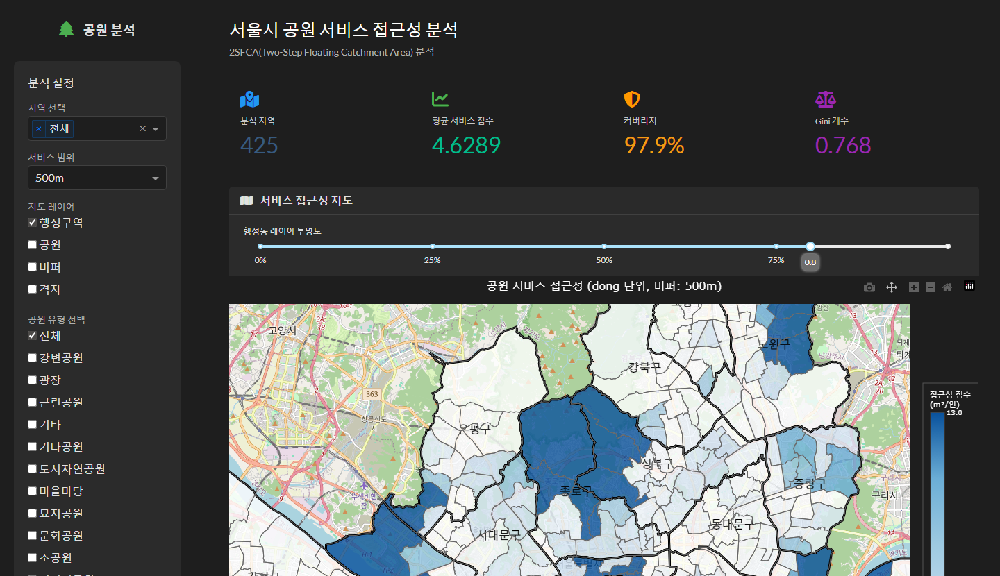
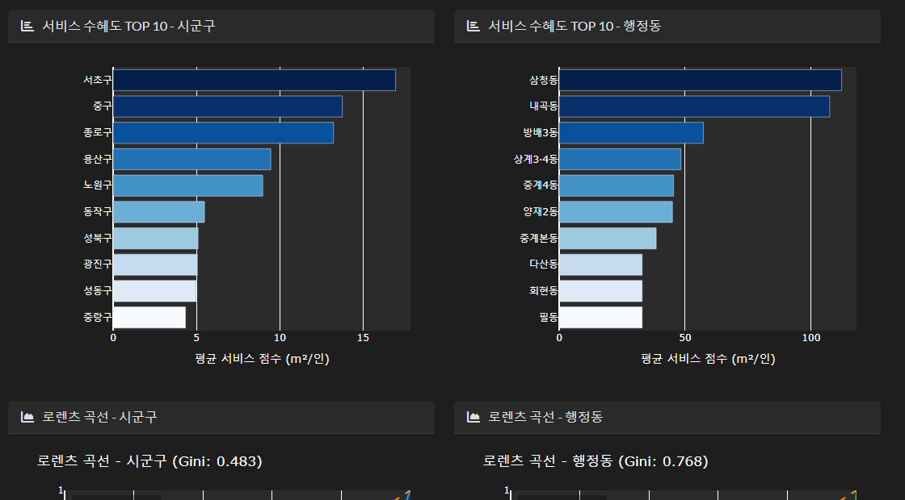
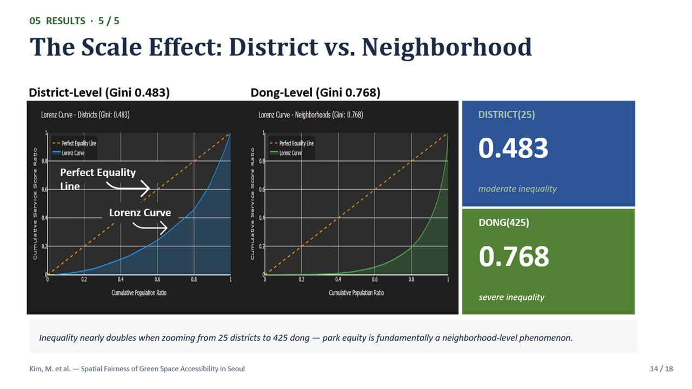
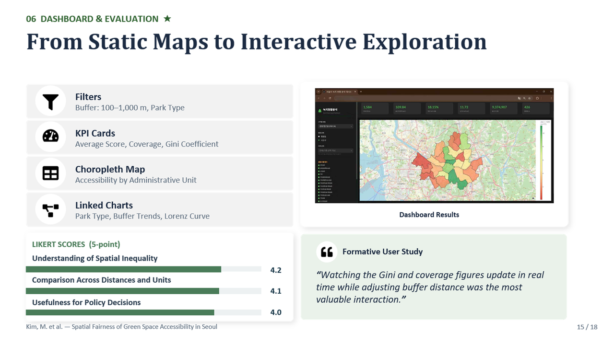

# 서울시 공원 접근성을 통한 도시 공간 불평등의 데이터 기반 분석

2024.03 – 2026.08 · 성균관대학교 정보통신대학원 빅데이터학과 석사 연구 · 단독 연구 (데이터 구축 · 2SFCA · 형평성 분석 · Dash 대시보드 · 사용자 평가 · 논문 · 발표)

| 구분 | 제목 | 발표처 · 시점 |
|---|---|---|
| 학위논문 | *A Data-Driven Analysis of Urban Spatial Inequality through Accessibility to Green Parks in Seoul* | 성균관대 정보통신대학원 빅데이터학과 석사, 2026.08 졸업 |
| 학회 논문 | *Analyzing Urban Spatial Inequality through Accessibility to Green Parks in Seoul* | **HCI International 2026** (캐나다 몬트리올), **구두 발표 2026.07.30**, Paper 4878 |

두 논문은 내용이 같고 제목만 다릅니다.

## 프로젝트 소개

서울시 1,888개 도시공원과 100m 격자 인구를 결합해 행정동별 공원 접근성을 **2SFCA(Two-Step Floating Catchment Area)** 로 산출하고, 지니계수·Lorenz Curve·커버리지로 공간 형평성을 평가한 연구입니다. 결과는 비전문가도 탐색할 수 있도록 **Plotly Dash + MapLibre 대시보드**로 구현했고, 공공정책 프로젝트 경험자 4명의 형성 평가를 거쳐 학위논문과 HCI International 2026 구두 발표로 이어졌습니다.

연구 설계부터 데이터 구축, 분석, 대시보드 구현, 형성 평가, 논문 집필, 영어 발표까지 단독으로 수행했습니다 (지도교수·공저자 교수 자문).

## 문제 정의

- **배경**: 1인당 공원면적 같은 평균 지표는 생활권별 접근성 차이를 설명하지 못한다. 공원이 행정구역 안에 있어도 보행거리·주변 인구·공원 규모에 따라 체감 접근성이 다르다.
- **연구 질문**
  1. 공급과 수요를 함께 고려한 접근성은 행정동별로 얼마나 불평등한가?
  2. 분석 단위(자치구 vs 행정동)에 따라 격차는 어떻게 달라지는가?
  3. 결과를 비전문가도 탐색할 수 있게 어떻게 보여줄 것인가?

## 데이터

| 데이터 | 출처 | 규모 | 레포 포함 여부 |
|---|---|---|---|
| 도시공원 폴리곤 | UPIS(도시계획정보체계) | 1,888개, 16개 유형 | 가공본 `seoul_parks.geojson` 포함 |
| 100m 격자 인구 | 국토정보플랫폼 | 서울 전역 | **미포함** (`notebooks/9_격자_인구데이터생성.ipynb`로 생성) |
| 행정동·시군구 경계 | 브이월드(행안부)·센서스 | 425~426개 동 | 가공본 `seoul_dong_with_pop.geojson` 포함 |
| (초기 검토) Landsat NDVI 2024, POI | 국토정보플랫폼 | - | 최종 미사용, 미포함 |

- **원천 데이터(약 4 GB, shp·격자·위성영상)는 포함하지 않습니다.** 원천 폴더(`s1_data/s1_org_data/`)와 shp 계열, 100m 격자 파일은 제외했습니다.
- `data/processed/`에는 분석 결과 재현과 대시보드 실행에 필요한 **가공 GeoJSON/CSV(25 MB 미만 파일만, 총 약 80 MB)** 를 포함했습니다. 목록과 크기는 `_manifest.md`에 있습니다.

## 분석 방법

1. **데이터 구축** — 좌표계 EPSG:5179 통일, 공원 × 격자 교차(R-tree 공간 인덱스), 웹용 EPSG:4326 변환 (`0_pre_data`, `1_데이터구축`, `9_격자_인구데이터생성`)
2. **2SFCA** — 1단계 공원별 공급/수요 비율 `R_j = S_j / ΣP_k`, 2단계 격자별 접근성 `A_i = ΣR_j`, 행정동으로 인구 가중 집계 (`2_공원중심_서비스권역분석`)
3. **다중 서비스 거리** 100 / 300 / 500 / 1,000 m와 공원 유형별 비교 (`3_다중버퍼_공원유형별_분석_최적화.py`)
4. **형평성** — 지니계수, Lorenz Curve, 커버리지 비율을 자치구·행정동 두 단위로 산출 (`4_공원접근성_시각화_분석`, EN 버전 동일)
5. **대시보드** — Plotly Dash + MapLibre, 시군구·거리·공원 유형 필터, KPI 카드, 콜백 16개, 백분위수 색상 스케일, GeoJSON 단순화 (`dashboard/`)
6. **형성 평가** — 공공정책 프로젝트 경험자 4명, 5점 척도 2문항(공간 불평등 이해 / 정책 의사결정 유용)


방법론과 구현 상세는 `docs/01_방법론.md`, `docs/02_공원중심_서비스권역_분석_완료.md`, `docs/03_구현_상세.md`, `docs/04_지표분석_검토.md`를 참고하세요.

## 기술 스택

- **언어·분석**: Python, Pandas, GeoPandas, Shapely, NumPy/SciPy
- **시각화·대시보드**: Plotly, Dash (Bootstrap Components), MapLibre GL
- **GIS**: QGIS (검수·지도 제작)
- **코드 규모**: 노트북 6개 + 분석 스크립트 1개, `dashboard/app_final.py` 약 1,200줄 + modules (한국어/영어 버전)

## 결과

- **지니계수: 자치구 0.483 vs 행정동 0.768** — 분석 단위가 세분화될수록 격차가 크게 드러남 (스케일 의존)
- **커버리지: 100m 35.2% → 300m 87.6%** — 300m가 접근성 점수와 커버리지의 균형 기준
- 어린이공원은 공원 수의 56.5%이지만 기여도는 제한적, **도시자연공원 기여도 60.7%**
- 대시보드 형성 평가 **평균 4.0 / 5** (점수 5·4·4·3). 정성 의견: "직관적이고 사용하기 쉽다", "정책 논의 참고자료로 적합"
- HCI International 2026 구두 발표 완료, 석사 학위 취득

| 대시보드 메인 | 형평성 분석 |
|---|---|
|  |  |

| 발표 — 결과 슬라이드 | 발표 — 대시보드 평가 |
|---|---|
|  |  |

## 실행 방법

### 환경

- Python 3.12 이상, 메모리 8 GB 이상 권장 (GeoJSON 로딩)
- `pip install -r requirements.txt` (루트: 노트북 + 대시보드 공통. 대시보드만 쓸 경우 `dashboard/requirements.txt`)

### 1) 대시보드 실행

`dashboard/modules/config.py`는 데이터 경로를 `dashboard/`의 상위 폴더 기준 `s1_data/s2_processed_data/`로 가정합니다. 둘 중 하나를 선택하세요.

```bash
# 방법 A: config.py가 기대하는 위치로 데이터 복사 (레포 루트에서)
mkdir -p s1_data/s2_processed_data
cp data/processed/* s1_data/s2_processed_data/

# 방법 B: config.py의 경로를 레포 구조에 맞게 수정
#   S1_DATA_PATH = PROJECT_ROOT.parent / 'data' / 'processed'

cd dashboard
python app_final.py        # 한국어 / app_final_en.py: 영어
# 브라우저에서 http://127.0.0.1:8050
```

- `config.py`의 `CSV_2SFCA`(`dong_service_score_fixed.csv`)는 경로만 정의되어 있고 현재 `app_final.py`는 2SFCA 결과를 `dong_service_score.geojson`에서 직접 읽으므로 실행에 필요하지 않습니다. 필요하면 `notebooks/2_공원중심_서비스권역분석.ipynb`가 같은 스키마의 `dong_service_score.csv`를 생성합니다.
- 100m 격자(`seoul_100m_grid_population.shp`)는 지도에서 "격자" 레이어를 켤 때만 지연 로딩됩니다. 파일이 없으면 격자 레이어를 켜지 말거나 `notebooks/9_격자_인구데이터생성.ipynb`로 생성하세요.
- 서버 IP 안내 문자열은 `<서버IP>`로 마스킹되어 있습니다.

### 2) 분석 재현 (노트북)

실행 순서: `0_pre_data` → `1_데이터구축` → `9_격자_인구데이터생성` → `2_공원중심_서비스권역분석` → `3_다중버퍼_공원유형별_분석_최적화.py` → `4_공원접근성_시각화_분석` (또는 `_EN`).

- `0`, `1`, `9`는 **원천 데이터(UPIS shp, 국토정보플랫폼 격자, 센서스 경계)** 가 필요하며 레포에 포함되어 있지 않습니다. 각 기관 사이트에서 내려받은 뒤 노트북 상단의 경로를 환경에 맞게 수정하세요.
- `2`, `3`, `4`는 `data/processed/`의 가공 데이터로 대부분 재실행할 수 있습니다 (격자 shp 제외). 노트북 안의 하드코딩 경로(`s1_data/s2_processed_data/` 등)는 환경에 맞게 수정하세요.
- 노트북의 출력 셀은 모두 제거되어 있습니다.

## 폴더 구조

```
seoul-park-accessibility/
├── README.md
├── requirements.txt                 # 노트북 + 대시보드 공통 의존성
├── notebooks/                       # 데이터 구축 · 2SFCA · 다중버퍼 · 시각화 분석
│   ├── 0_pre_data.ipynb
│   ├── 1_데이터구축.ipynb
│   ├── 2_공원중심_서비스권역분석.ipynb
│   ├── 3_다중버퍼_공원유형별_분석_최적화.py
│   ├── 4_공원접근성_시각화_분석.ipynb
│   ├── 4_Park_Accessibility_Visualization_Analysis_EN.ipynb
│   └── 9_격자_인구데이터생성.ipynb
├── dashboard/                       # Plotly Dash 대시보드
│   ├── app_final.py                 # 한국어 (약 1,200줄)
│   ├── app_final_en.py              # 영어
│   ├── modules/                     # config · data_loader · visualizations
│   ├── requirements.txt
│   └── CHANGELOG.md
├── data/processed/                  # 가공 GeoJSON/CSV (25 MB 미만, 원천 미포함)
│   ├── dong_service_score*.geojson  # 2SFCA 결과 (기본 + 100/300/500/1000m)
│   ├── seoul_parks.geojson · seoul_dong_with_pop.geojson
│   └── *.csv                        # 다중버퍼·공원유형별, 커버리지, 시군구 비교, 통계 요약
└── docs/
    ├── 01_방법론.md · 02_공원중심_서비스권역_분석_완료.md · 03_구현_상세.md · 04_지표분석_검토.md
    └── images/                      # 대시보드 · 발표 캡쳐
```

## 참고

- Obsidian 노트: `2024-03_석사연구_서울시_공원접근성_2SFCA`
- 관련 레포: 지니계수·Lorenz 분석의 출발점이 된 `2023-06_양주시_지역불균형_실태분석` (라임솔루션 재직 중 수행)
- 학위논문 원문과 HCII 2026 발표 자료는 공개 레포에 포함하지 않습니다 (학위논문은 학교 도서관, 학회 논문은 Springer 프로시딩을 통해 열람).
- `06.dash_app/`, `QGIS/` 등 본인 작성물이 아닌 폴더는 포함하지 않았습니다.
